  <picture><source media="(max-width: 600px) and (prefers-reduced-motion: reduce)" srcset="./assets/still/motion-header-mobile.svg" /><source media="(prefers-reduced-motion: reduce)" srcset="./assets/still/motion-header.svg" />
    <source media="(max-width: 600px)" srcset="./assets/motion-header-mobile.svg" />
    
  </picture>

  <a href="./assets/PruthviRajPudiResume.pdf"><strong>Resume</strong></a> &nbsp; · &nbsp;
  <a href="https://www.linkedin.com/in/pruthvirajpudi/">LinkedIn</a> &nbsp; · &nbsp;
  <a href="mailto:pruthvirajpudi@gmail.com">Email</a>

I build data pipelines, write SQL, and create reports in Power BI and Excel.

3+ years in operations at Amazon and Accenture · M.S. Data Science, Pace University · GPA 3.79

### Tech stack

  <picture><source media="(max-width: 600px) and (prefers-reduced-motion: reduce)" srcset="./assets/still/tech-stack-mobile.svg" /><source media="(prefers-reduced-motion: reduce)" srcset="./assets/still/tech-stack.svg" />
    <source media="(max-width: 600px)" srcset="./assets/tech-stack-mobile.svg" />
    
  </picture>

### Selected projects

  <a href="https://github.com/pruthviiraj/olist-marketplace-pipeline"><picture><source media="(max-width: 600px) and (prefers-reduced-motion: reduce)" srcset="./assets/still/motion-cards/olist-mobile.svg" /><source media="(prefers-reduced-motion: reduce)" srcset="./assets/still/motion-cards/olist.svg" /><source media="(max-width: 600px)" srcset="./assets/motion-cards/olist-mobile.svg" /></picture></a>
  <a href="https://github.com/pruthviiraj/Excel-Projects/tree/main/Sales%20%26%20Financial%20Performance%20Analysis"><picture><source media="(max-width: 600px) and (prefers-reduced-motion: reduce)" srcset="./assets/still/motion-cards/sales-mobile.svg" /><source media="(prefers-reduced-motion: reduce)" srcset="./assets/still/motion-cards/sales.svg" /><source media="(max-width: 600px)" srcset="./assets/motion-cards/sales-mobile.svg" /></picture></a>
   
  <a href="https://github.com/pruthviiraj/crm-and-erp-sales-data-warehouse-project"><picture><source media="(max-width: 600px) and (prefers-reduced-motion: reduce)" srcset="./assets/still/motion-cards/warehouse-mobile.svg" /><source media="(prefers-reduced-motion: reduce)" srcset="./assets/still/motion-cards/warehouse.svg" /><source media="(max-width: 600px)" srcset="./assets/motion-cards/warehouse-mobile.svg" /></picture></a>
  <a href="https://app.powerbi.com/view?r=eyJrIjoiMmQxMTk5YTktNzg4Yy00N2VkLTk5MDItNjg1MjU0NDIzMzliIiwidCI6ImIyN2RhZWIzLThjZmUtNDFiNi1iYTNhLWY1MzRhNGMzN2ZhNCJ9"><picture><source media="(max-width: 600px) and (prefers-reduced-motion: reduce)" srcset="./assets/still/motion-cards/hr-mobile.svg" /><source media="(prefers-reduced-motion: reduce)" srcset="./assets/still/motion-cards/hr.svg" /><source media="(max-width: 600px)" srcset="./assets/motion-cards/hr-mobile.svg" /></picture></a>

### GitHub activity

  <a href="https://github.com/pruthviiraj"><picture><source media="(prefers-reduced-motion: reduce)" srcset="https://github-readme-stats.vercel.app/api?username=pruthviiraj&amp;show_icons=true&amp;hide_rank=true&amp;hide=stars&amp;bg_color=111827&amp;title_color=38bdf8&amp;text_color=cbd5e1&amp;icon_color=a78bfa&amp;border_color=28354d&amp;border_radius=10&amp;custom_title=GitHub%20Overview&amp;card_width=450&amp;disable_animations=true" /></picture></a>
  <a href="https://github.com/pruthviiraj"><picture><source media="(prefers-reduced-motion: reduce)" srcset="https://streak-stats.demolab.com?user=pruthviiraj&amp;background=111827&amp;border=28354D&amp;stroke=28354D&amp;ring=818CF8&amp;fire=38BDF8&amp;currStreakNum=F1F5F9&amp;sideNums=F1F5F9&amp;currStreakLabel=38BDF8&amp;sideLabels=CBD5E1&amp;dates=94A3B8&amp;border_radius=10&amp;disable_animations=true" /></picture></a>

  

    <a href="https://github.com/pruthviiraj"><picture><source media="(prefers-reduced-motion: reduce)" srcset="https://github-profile-summary-cards.vercel.app/api/cards/profile-details?username=pruthviiraj&amp;theme=tokyonight&amp;title_color=38bdf8&amp;text_color=cbd5e1&amp;bg_color=111827&amp;chart_color=818cf8&amp;name=Contribution%20activity&amp;animation=none&amp;duration=1.8" /></picture></a>
  

---

Open to roles in **data analytics and data engineering**. [Get in touch](mailto:pruthvirajpudi@gmail.com).
