<picture>
  <source media="(prefers-reduced-motion: reduce) and (prefers-color-scheme: dark)" srcset="./assets/previews/static/motion-header-dark.svg" />
  <source media="(prefers-reduced-motion: reduce)" srcset="./assets/previews/static/motion-header-light.svg" />
  <source media="(prefers-color-scheme: dark)" srcset="./assets/motion-header-dark.svg" />
  
</picture>

  &nbsp;
  &nbsp;
  &nbsp;
  

## About

- **Focus** — Data analytics and data engineering for e-commerce, sales and workforce data.
- **Builds** — SQL, Python and BI projects that take operational data through cleaning, modeling and reporting.
- **Background** — M.S. in Data Science from Pace University, with 3+ years in operations at Amazon and Accenture.
- **Work style** — Track service targets, manage cases, and check data quality before reporting results.

## Toolkit

<picture>
  <source media="(prefers-reduced-motion: reduce) and (prefers-color-scheme: dark)" srcset="./assets/previews/static/motion-skills-dark.svg" />
  <source media="(prefers-reduced-motion: reduce)" srcset="./assets/previews/static/motion-skills-light.svg" />
  <source media="(prefers-color-scheme: dark)" srcset="./assets/motion-skills-dark.svg" />
  
</picture>

## GitHub activity

<picture>
  <source media="(prefers-reduced-motion: reduce) and (prefers-color-scheme: dark)" srcset="./assets/previews/static/activity-motion-dark.svg" />
  <source media="(prefers-reduced-motion: reduce)" srcset="./assets/previews/static/activity-motion-light.svg" />
  <source media="(prefers-color-scheme: dark)" srcset="./assets/activity-motion-dark.svg" />
  
</picture>

  <a href="https://github.com/pruthviiraj"><picture><source media="(prefers-reduced-motion: reduce)" srcset="https://github-readme-stats.vercel.app/api?username=pruthviiraj&amp;show_icons=true&amp;hide_rank=true&amp;hide=stars&amp;bg_color=111827&amp;title_color=93c5fd&amp;text_color=cbd5e1&amp;icon_color=a5b4fc&amp;border_color=334155&amp;border_radius=12&amp;custom_title=GitHub+Overview&amp;card_width=450&amp;line_height=31&amp;disable_animations=true" /></picture></a>
  <a href="https://github.com/pruthviiraj"><picture><source media="(prefers-reduced-motion: reduce)" srcset="https://streak-stats.demolab.com?user=pruthviiraj&amp;background=111827&amp;border=334155&amp;stroke=334155&amp;ring=818CF8&amp;fire=93C5FD&amp;currStreakNum=F1F5F9&amp;sideNums=F1F5F9&amp;currStreakLabel=93C5FD&amp;sideLabels=CBD5E1&amp;dates=94A3B8&amp;border_radius=12&amp;card_width=450&amp;card_height=200&amp;disable_animations=true" /></picture></a>

## Selected projects

<picture>
  <source media="(prefers-reduced-motion: reduce) and (prefers-color-scheme: dark)" srcset="./assets/previews/static/projects-parallel-dark.svg" />
  <source media="(prefers-reduced-motion: reduce)" srcset="./assets/previews/static/projects-parallel-light.svg" />
  <source media="(prefers-color-scheme: dark)" srcset="./assets/projects-parallel-dark.svg" />
  
</picture>

1. [**Olist marketplace data pipeline**](https://github.com/pruthviiraj/olist-marketplace-pipeline) — Python ingestion and ten dbt models that move e-commerce data into Snowflake. Validation and reporting are in progress.
2. [**Sales &amp; financial performance**](https://github.com/pruthviiraj/Excel-Projects/tree/main/Sales%20%26%20Financial%20Performance%20Analysis) — Eight Excel reports covering sales, targets and profit; the 2021 report shows a $54.9M shortfall against target.
3. [**CRM &amp; ERP sales warehouse**](https://github.com/pruthviiraj/crm-and-erp-sales-data-warehouse-project) — Customer and sales data combined in SQL Server, with missing-value and duplicate checks.
4. [**HR analytics dashboard**](https://app.powerbi.com/view?r=eyJrIjoiMmQxMTk5YTktNzg4Yy00N2VkLTk5MDItNjg1MjU0NDIzMzliIiwidCI6ImIyN2RhZWIzLThjZmUtNDFiNi1iYTNhLWY1MzRhNGMzN2ZhNCJ9) — Four Power BI pages for workforce and employee-turnover analysis across 1,470 sample employee records.

Open to roles in data analytics and data engineering. [Get in touch](mailto:pruthvirajpudi@gmail.com).
