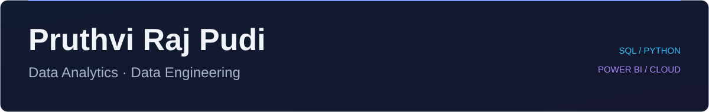
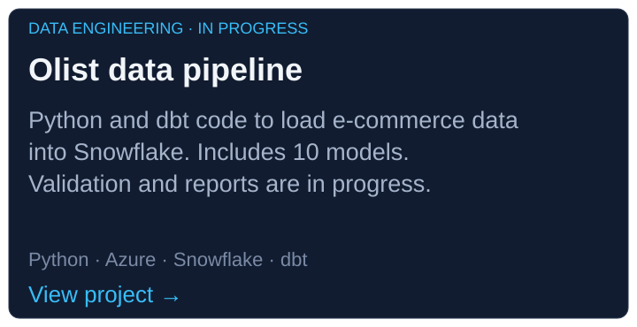
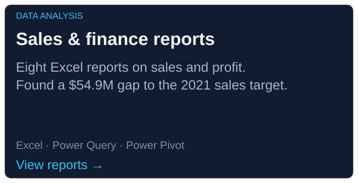
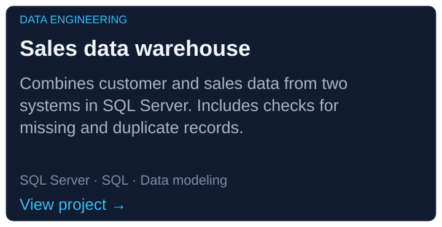
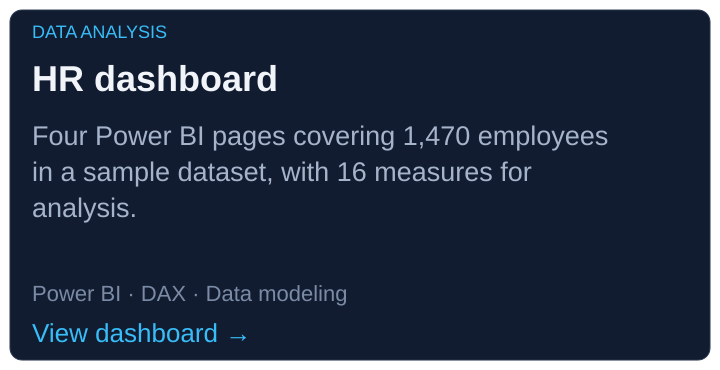

  <picture>
    <source media="(max-width: 600px)" srcset="./assets/profile-header-mobile.svg" />
    
  </picture>

  <a href="./assets/PruthviRajPudiResume.pdf"><strong>Resume</strong></a> &nbsp; · &nbsp;
  <a href="https://www.linkedin.com/in/pruthvirajpudi/">LinkedIn</a> &nbsp; · &nbsp;
  <a href="mailto:pruthvirajpudi@gmail.com">Email</a>

I build data pipelines, write SQL, and create reports in Power BI and Excel.

3+ years in operations at Amazon and Accenture · M.S. Data Science, Pace University · GPA 3.79

### Tools

   &nbsp;
   &nbsp;
   &nbsp;
   &nbsp;
   &nbsp;
   &nbsp;
   &nbsp;
   &nbsp;
   &nbsp;
   &nbsp;
   &nbsp;
   &nbsp;

### Selected projects

  <a href="https://github.com/pruthviiraj/olist-marketplace-pipeline"><picture><source media="(max-width: 600px)" srcset="./assets/cards/olist-mobile.svg" /></picture></a>
  <a href="https://github.com/pruthviiraj/Excel-Projects/tree/main/Sales%20%26%20Financial%20Performance%20Analysis"><picture><source media="(max-width: 600px)" srcset="./assets/cards/sales-mobile.svg" /></picture></a>
   
  <a href="https://github.com/pruthviiraj/crm-and-erp-sales-data-warehouse-project"><picture><source media="(max-width: 600px)" srcset="./assets/cards/warehouse-mobile.svg" /></picture></a>
  <a href="https://app.powerbi.com/view?r=eyJrIjoiMmQxMTk5YTktNzg4Yy00N2VkLTk5MDItNjg1MjU0NDIzMzliIiwidCI6ImIyN2RhZWIzLThjZmUtNDFiNi1iYTNhLWY1MzRhNGMzN2ZhNCJ9"><picture><source media="(max-width: 600px)" srcset="./assets/cards/hr-mobile.svg" /></picture></a>

### GitHub activity

  
  

  
Contribution history

  

    
  

---

Open to roles in **data analytics and data engineering**. [Get in touch](mailto:pruthvirajpudi@gmail.com).
