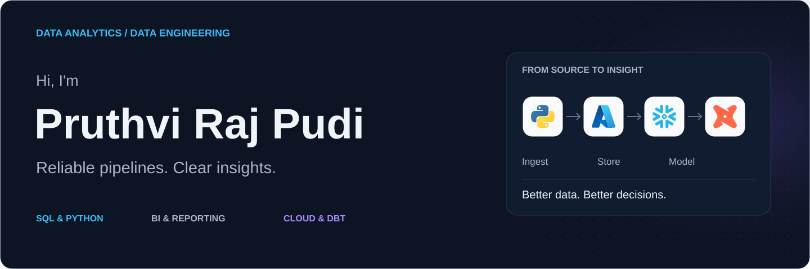
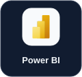
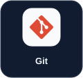
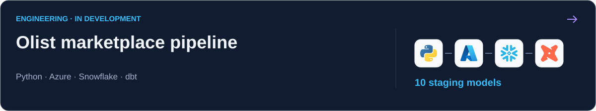
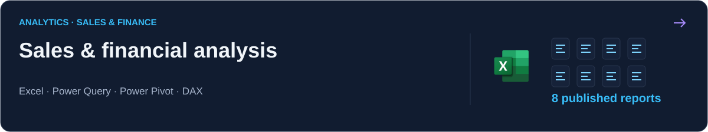
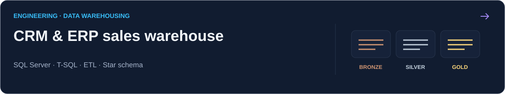
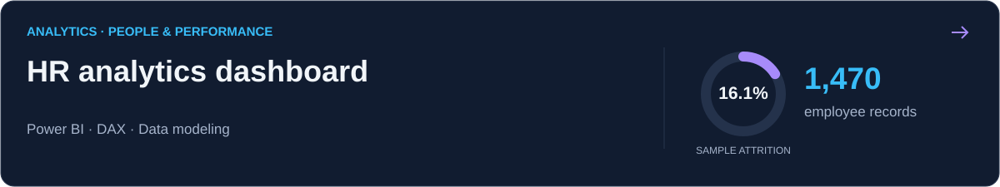

  <picture>
    <source media="(max-width: 600px)" srcset="./assets/hero-mobile.svg" />
    
  </picture>

  <a href="#tools--technologies">Tools</a> &nbsp; · &nbsp;
  <a href="#github-activity">GitHub activity</a> &nbsp; · &nbsp;
  <a href="#selected-projects">Projects</a> &nbsp; · &nbsp;
  <a href="./assets/PruthviRajPudiResume.pdf">Résumé</a> &nbsp; · &nbsp;
  <a href="https://www.linkedin.com/in/pruthvirajpudi/">LinkedIn</a> &nbsp; · &nbsp;
  <a href="mailto:pruthvirajpudi@gmail.com">Email</a>

I connect **data analytics and data engineering**, from cloud ingestion and warehouse models to dashboards and business insights.

**3+ years in operations at Amazon and Accenture** shape how I approach data quality and reporting. **M.S. Data Science, Pace University · GPA 3.79.**

## Tools & technologies

  
  
  
  
  
  
   
  
  
  
  
  
  

## GitHub activity

  
  

  

## Selected projects

  <a href="https://github.com/pruthviiraj/olist-marketplace-pipeline"><picture>
    <source media="(max-width: 600px)" srcset="./assets/projects/olist-mobile.svg" />
    
  </picture></a>

Cloud ingestion, **10 documented dbt staging models**, and a review-translation prototype. **Next:** warehouse validation, reporting models, and a dashboard. [Explore pipeline →](https://github.com/pruthviiraj/olist-marketplace-pipeline)

 

  <a href="https://github.com/pruthviiraj/Excel-Projects/tree/main/Sales%20%26%20Financial%20Performance%20Analysis"><picture>
    <source media="(max-width: 600px)" srcset="./assets/projects/sales-mobile.svg" />
    
  </picture></a>

**8 reports** connect customer, market, and P&L analysis, including a **$54.9M sales target gap** in 2021. [Explore analysis →](https://github.com/pruthviiraj/Excel-Projects/tree/main/Sales%20%26%20Financial%20Performance%20Analysis)

 

  <a href="https://github.com/pruthviiraj/crm-and-erp-sales-data-warehouse-project"><picture>
    <source media="(max-width: 600px)" srcset="./assets/projects/warehouse-mobile.svg" />
    
  </picture></a>

Integrated CRM and ERP data through **Bronze → Silver → Gold**, with a star schema, SQL quality checks, and a data catalog. [Explore warehouse →](https://github.com/pruthviiraj/crm-and-erp-sales-data-warehouse-project)

 

  <a href="https://app.powerbi.com/view?r=eyJrIjoiMmQxMTk5YTktNzg4Yy00N2VkLTk5MDItNjg1MjU0NDIzMzliIiwidCI6ImIyN2RhZWIzLThjZmUtNDFiNi1iYTNhLWY1MzRhNGMzN2ZhNCJ9"><picture>
    <source media="(max-width: 600px)" srcset="./assets/projects/hr-mobile.svg" />
    
  </picture></a>

A **4-page Power BI dashboard** with **16 DAX measures**, exploring workforce patterns and **16.1% attrition** in a sample employee dataset. [View dashboard →](https://app.powerbi.com/view?r=eyJrIjoiMmQxMTk5YTktNzg4Yy00N2VkLTk5MDItNjg1MjU0NDIzMzliIiwidCI6ImIyN2RhZWIzLThjZmUtNDFiNi1iYTNhLWY1MzRhNGMzN2ZhNCJ9)

## Let's connect

Open to opportunities in **data analytics and data engineering**.

[Email](mailto:pruthvirajpudi@gmail.com) &nbsp; · &nbsp; [LinkedIn](https://www.linkedin.com/in/pruthvirajpudi/) &nbsp; · &nbsp; [Résumé](./assets/PruthviRajPudiResume.pdf) &nbsp; · &nbsp; [Learning log](https://github.com/pruthviiraj/my-learnings)

Project findings describe public or sample datasets. [Design references and visual credits](./docs/design-references.md).
