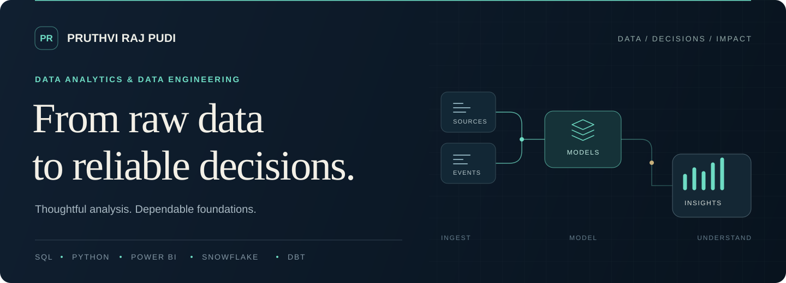
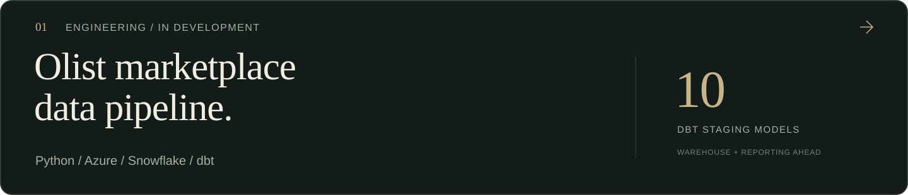
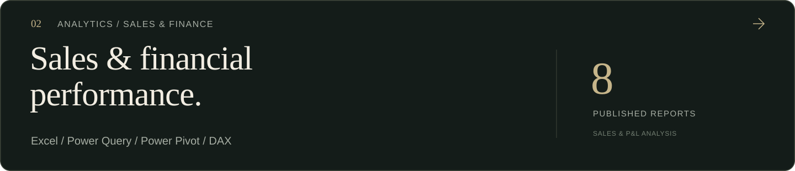
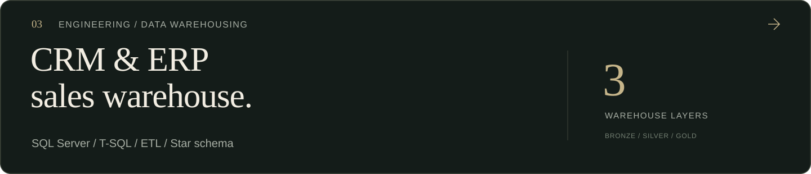
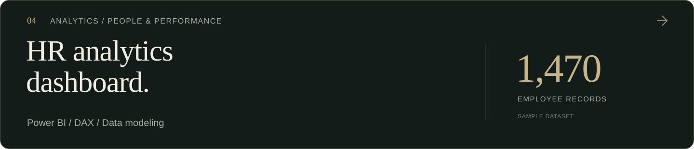

  <picture>
    <source media="(max-width: 600px)" srcset="./assets/profile-cover-mobile.svg" />
    
  </picture>

  <a href="#selected-work">Work</a> &nbsp; · &nbsp;
  <a href="#toolkit">Toolkit</a> &nbsp; · &nbsp;
  <a href="./assets/PruthviRajPudiResume.pdf">Résumé</a> &nbsp; · &nbsp;
  <a href="https://www.linkedin.com/in/pruthvirajpudi/">LinkedIn</a> &nbsp; · &nbsp;
  <a href="mailto:pruthvirajpudi@gmail.com">Email</a>

I work across **data analytics and data engineering**, turning raw data into reliable models and clear business insights.

My **3+ years in operations at Amazon and Accenture** inform how I approach data quality, reporting, and the decisions behind the numbers.

M.S. Data Science · Pace University · GPA 3.79

## Selected work

  <a href="https://github.com/pruthviiraj/olist-marketplace-pipeline">
    <picture>
      <source media="(max-width: 600px)" srcset="./assets/project-olist-mobile.svg" />
      
    </picture>
  </a>

Cloud ingestion, documented staging models, and AI review-translation prototyping. **Next:** warehouse validation, business reporting, and dashboarding. [Explore pipeline →](https://github.com/pruthviiraj/olist-marketplace-pipeline)

 

  <a href="https://github.com/pruthviiraj/Excel-Projects/tree/main/Sales%20%26%20Financial%20Performance%20Analysis">
    <picture>
      <source media="(max-width: 600px)" srcset="./assets/project-sales-mobile.svg" />
      
    </picture>
  </a>

Eight reports connect market targets and profitability, including a **$54.9M sales target gap** in 2021. [Explore analysis →](https://github.com/pruthviiraj/Excel-Projects/tree/main/Sales%20%26%20Financial%20Performance%20Analysis)

 

  <a href="https://github.com/pruthviiraj/crm-and-erp-sales-data-warehouse-project">
    <picture>
      <source media="(max-width: 600px)" srcset="./assets/project-warehouse-mobile.svg" />
      
    </picture>
  </a>

CRM and ERP sources become a dimensional sales model, with **SQL quality checks**, architecture diagrams, and a data catalog. [Explore warehouse →](https://github.com/pruthviiraj/crm-and-erp-sales-data-warehouse-project)

 

  <a href="https://app.powerbi.com/view?r=eyJrIjoiMmQxMTk5YTktNzg4Yy00N2VkLTk5MDItNjg1MjU0NDIzMzliIiwidCI6ImIyN2RhZWIzLThjZmUtNDFiNi1iYTNhLWY1MzRhNGMzN2ZhNCJ9">
    <picture>
      <source media="(max-width: 600px)" srcset="./assets/project-hr-mobile.svg" />
      
    </picture>
  </a>

A **4-page dashboard with 16 DAX measures** explores workforce patterns and **16.1% attrition** in a sample employee dataset. [View dashboard →](https://app.powerbi.com/view?r=eyJrIjoiMmQxMTk5YTktNzg4Yy00N2VkLTk5MDItNjg1MjU0NDIzMzliIiwidCI6ImIyN2RhZWIzLThjZmUtNDFiNi1iYTNhLWY1MzRhNGMzN2ZhNCJ9)

## Toolkit

| Analytics | Engineering |
| :--- | :--- |
| SQL · Power BI · Excel · DAX | Python · pandas · dbt |
| Power Query · Power Pivot · Looker Studio | Snowflake · SQL Server · Azure Blob Storage |
| Business reporting · Data visualization | ETL · Dimensional modeling · Data quality |

Explore my [SQL practice and learning notes](https://github.com/pruthviiraj/my-learnings). Portfolio findings describe public or sample datasets.

## Let's connect

Open to opportunities in **data analytics and data engineering**.

[Email me](mailto:pruthvirajpudi@gmail.com) &nbsp; · &nbsp; [LinkedIn](https://www.linkedin.com/in/pruthvirajpudi/) &nbsp; · &nbsp; [Résumé](./assets/PruthviRajPudiResume.pdf)
