<picture>
  <source media="(prefers-color-scheme: dark)" srcset="./assets/profile-visual-dark.svg" />
  
</picture>

<h1 align="center">Pruthvi Raj Pudi</h1>

Data Analytics &nbsp;·&nbsp; Data Engineering

  <a href="./assets/PruthviRajPudiResume.pdf">Resume</a> &nbsp; · &nbsp;
  <a href="https://www.linkedin.com/in/pruthvirajpudi/">LinkedIn</a> &nbsp; · &nbsp;
  <a href="mailto:pruthvirajpudi@gmail.com">Email</a>

> Data projects in e-commerce, sales, and workforce reporting.

## About

I build SQL, Python and BI projects that take operational data through cleaning, modeling and reporting.

I have an M.S. in Data Science from Pace University and 3+ years in operations at Amazon and Accenture, where I tracked service targets, managed cases and checked data quality.

## Featured work

<a href="https://github.com/pruthviiraj/olist-marketplace-pipeline"><picture><source media="(prefers-reduced-motion: reduce)" srcset="./assets/previews/static/olist-flow.svg" /></picture></a>

### Olist marketplace data pipeline

Python ingestion and ten dbt models move Olist e-commerce data into Snowflake. Validation and reporting are in progress.

[Explore the pipeline →](https://github.com/pruthviiraj/olist-marketplace-pipeline)

## Selected work

### 01 — Sales & financial performance

Eight Excel reports covering sales, targets and profit. The 2021 report shows a $54.9M shortfall against target. [View reports →](https://github.com/pruthviiraj/Excel-Projects/tree/main/Sales%20%26%20Financial%20Performance%20Analysis)

### 02 — CRM & ERP sales warehouse

Customer and sales data combined in SQL Server, with missing-value and duplicate checks. [View code →](https://github.com/pruthviiraj/crm-and-erp-sales-data-warehouse-project)

### 03 — HR analytics dashboard

Four Power BI pages for workforce and employee-turnover analysis across 1,470 sample employee records. [Open dashboard →](https://app.powerbi.com/view?r=eyJrIjoiMmQxMTk5YTktNzg4Yy00N2VkLTk5MDItNjg1MjU0NDIzMzliIiwidCI6ImIyN2RhZWIzLThjZmUtNDFiNi1iYTNhLWY1MzRhNGMzN2ZhNCJ9)

## Toolkit

| Focus | Tools |
| :-- | :-- |
| Data preparation |  Python &nbsp;  pandas |
| Cloud & warehouse |  Azure &nbsp;  Snowflake |
| Databases |  SQL Server &nbsp;  PostgreSQL |
| Reporting |  Power BI &nbsp;  Excel |
| Transformation |  dbt &nbsp;  Looker Studio |
| Workflow |  Git &nbsp;  GitHub |

## GitHub activity

  <a href="https://github.com/pruthviiraj"><picture><source media="(prefers-reduced-motion: reduce)" srcset="https://github-readme-stats.vercel.app/api?username=pruthviiraj&amp;show_icons=true&amp;hide_rank=true&amp;hide=stars&amp;bg_color=111827&amp;title_color=93c5fd&amp;text_color=cbd5e1&amp;icon_color=a5b4fc&amp;border_color=334155&amp;border_radius=12&amp;custom_title=GitHub+Overview&amp;card_width=450&amp;line_height=31&amp;disable_animations=true" /></picture></a>
  <a href="https://github.com/pruthviiraj"><picture><source media="(prefers-reduced-motion: reduce)" srcset="https://streak-stats.demolab.com?user=pruthviiraj&amp;background=111827&amp;border=334155&amp;stroke=334155&amp;ring=818CF8&amp;fire=93C5FD&amp;currStreakNum=F1F5F9&amp;sideNums=F1F5F9&amp;currStreakLabel=93C5FD&amp;sideLabels=CBD5E1&amp;dates=94A3B8&amp;border_radius=12&amp;card_width=450&amp;card_height=200&amp;disable_animations=true" /></picture></a>

Open to roles in data analytics and data engineering. [Get in touch](mailto:pruthvirajpudi@gmail.com).
