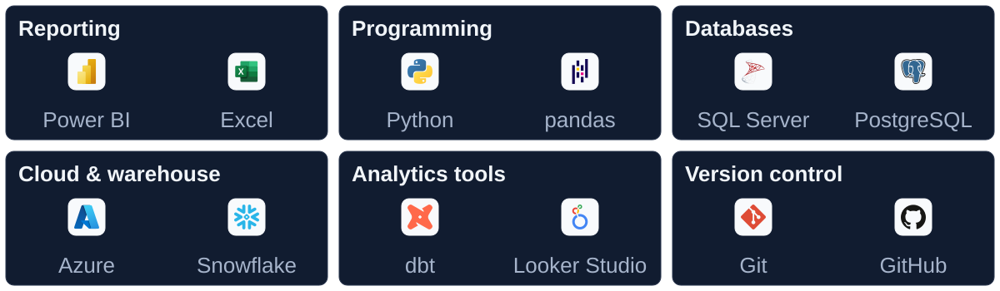
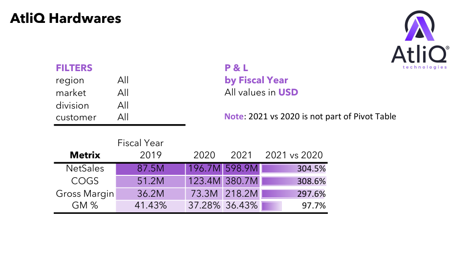
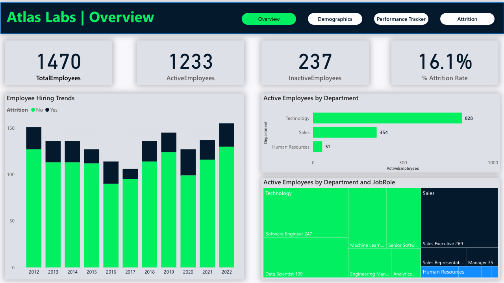

<h1 align="center">Pruthvi Raj Pudi</h1>

Data Analytics · Data Engineering

  <a href="./assets/PruthviRajPudiResume.pdf">Resume</a> &nbsp; · &nbsp;
  <a href="https://www.linkedin.com/in/pruthvirajpudi/">LinkedIn</a> &nbsp; · &nbsp;
  <a href="mailto:pruthvirajpudi@gmail.com">Email</a>

## About

I work with SQL, Python, Power BI and Excel to build data pipelines and reports. My projects focus on e-commerce operations, sales and employee data.

I have an M.S. in Data Science from Pace University and 3+ years in operations at Amazon and Accenture. My work there involved tracking service targets, managing cases and checking data quality.

## Tech stack

  <picture><source media="(max-width: 600px)" srcset="./assets/previews/stack-mobile.svg" /></picture>

## Selected work

<table width="100%">
  <tr>
    <td width="50%" valign="top">
      <a href="https://github.com/pruthviiraj/olist-marketplace-pipeline"><picture><source media="(prefers-reduced-motion: reduce)" srcset="./assets/previews/static/olist-flow.svg" /></picture></a>
      <h3>Olist data pipeline</h3>
      
Python ingestion and ten dbt models for Olist e-commerce data in Snowflake. Validation and reporting are in progress.

      
<a href="https://github.com/pruthviiraj/olist-marketplace-pipeline">View code →</a>

    </td>
    <td width="50%" valign="top">
      
      <h3>Sales &amp; finance reports</h3>
      
Eight Excel reports on sales, targets and profit. The 2021 report shows a $54.9M shortfall against target.

      
<a href="https://github.com/pruthviiraj/Excel-Projects/tree/main/Sales%20%26%20Financial%20Performance%20Analysis">View reports →</a>

    </td>
  </tr>
  <tr>
    <td width="50%" valign="top">
      <a href="https://github.com/pruthviiraj/crm-and-erp-sales-data-warehouse-project"><picture><source media="(prefers-reduced-motion: reduce)" srcset="./assets/previews/static/warehouse-layers.svg" /></picture></a>
      <h3>Sales data warehouse</h3>
      
Combines customer and sales data in SQL Server, with checks for missing values and duplicate records.

      
<a href="https://github.com/pruthviiraj/crm-and-erp-sales-data-warehouse-project">View code →</a>

    </td>
    <td width="50%" valign="top">
      
      <h3>HR dashboard</h3>
      
Four Power BI pages covering 1,470 employees, with 16 measures for workforce and employee-turnover analysis. Uses sample data.

      
<a href="https://app.powerbi.com/view?r=eyJrIjoiMmQxMTk5YTktNzg4Yy00N2VkLTk5MDItNjg1MjU0NDIzMzliIiwidCI6ImIyN2RhZWIzLThjZmUtNDFiNi1iYTNhLWY1MzRhNGMzN2ZhNCJ9">Open dashboard →</a>

    </td>
  </tr>
</table>

## GitHub activity

  <a href="https://github.com/pruthviiraj"><picture><source media="(prefers-reduced-motion: reduce)" srcset="https://github-readme-stats.vercel.app/api?username=pruthviiraj&amp;show_icons=true&amp;hide_rank=true&amp;hide=stars&amp;bg_color=111827&amp;title_color=93c5fd&amp;text_color=cbd5e1&amp;icon_color=a5b4fc&amp;border_color=334155&amp;border_radius=12&amp;custom_title=GitHub+Overview&amp;card_width=450&amp;line_height=31&amp;disable_animations=true" /></picture></a>
  <a href="https://github.com/pruthviiraj"><picture><source media="(prefers-reduced-motion: reduce)" srcset="https://streak-stats.demolab.com?user=pruthviiraj&amp;background=111827&amp;border=334155&amp;stroke=334155&amp;ring=818CF8&amp;fire=93C5FD&amp;currStreakNum=F1F5F9&amp;sideNums=F1F5F9&amp;currStreakLabel=93C5FD&amp;sideLabels=CBD5E1&amp;dates=94A3B8&amp;border_radius=12&amp;card_width=450&amp;card_height=200&amp;disable_animations=true" /></picture></a>

Open to roles in data analytics and data engineering. [Get in touch](mailto:pruthvirajpudi@gmail.com).
